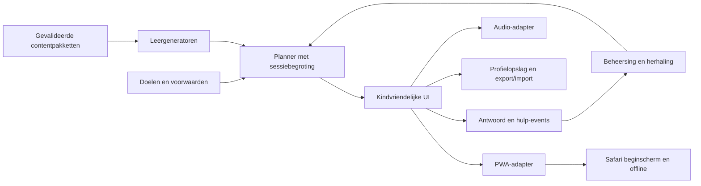

# Van MVP naar volledige Leesavontuur-app

## Productdoel

Een zesjarige kan met korte, positieve oefensessies doorgroeien van klankbewustzijn
naar zelfstandig lezen van passende woorden, zinnen en eenvoudige verhalen, met
begrip en toenemende nauwkeurigheid. De app helpt ouders/leerkrachten begeleiden;
zij levert geen diagnoses en belooft niet dat ieder kind zonder begeleiding leert
lezen. Een eindpunt is een **observeerbare leesprestatie**, niet een afgeronde kaart.

Definitieve stemrichting: **een warme, rustige menselijke stem in
Standaardnederlands**. De gegenereerde MP3s zijn tijdelijke ontwikkelconcepten.

## Implementatievolgorde en acceptatie

| Mijlpaal | Werk | Klaar wanneer |
|---|---|---|
| 0 — Technische basis, deze werkronde | Gebiedsselectie, eerste zinnen/verhalen, PWA, audiosequenties, touch-luisteren, profielimport, volledige klankrapportage, releasecontrole | Tests en offline browser-smoke slagen; open audio- en didactische punten staan expliciet beschreven |
| 1 — Didactische blauwdruk en menselijke audio | Leesexpert stelt grafeem-/patroonvolgorde, introductie van functiewoorden, foutmodellen en eindcriteria vast. Spreker neemt complete script op; tweede luisteraar controleert uitspraak en niveau. | Leerlijngraaf heeft geen onbereikbare doelen; alle actuele clips aanwezig, menselijk en per checksum goedgekeurd; contactadres correct ingevuld |
| 2 — Klanken naar woorden | Intake zonder toetsdruk; fonemisch bewustzijn naast eerste letters; beide richtingen letter-klank; hakken op klankposities; vloeiend plakken; gevarieerde decodeerbare woorden en minimale paren; betekenis na lezen | Verschillende kindprofielen kunnen vooruit, herhalen en hulp krijgen; elke ontgrendeling heeft voldoende bewijs over meerdere sessies; nieuwe woorden testen transfer |
| 3 — Woorden naar zinnen | Alle relevante grafemen/lettercombinaties, clusters, hoofdletters, functiewoorden, korte zinnen, uitspraak in context en eenvoudige grammaticale samenhang | Gedoseerde, decodeerbare zinbank; introductievoorwaarden automatisch gecontroleerd; begrip en leeshulp apart opgeslagen; geen voorspraak vóór zelfstandig lezen |
| 4 — Verhalen en zelfstandigheid | Gegradeerde verhalenbibliotheek; woordbetekenis, volgorde, verwijswoorden en eenvoudige gevolgtrekkingen; samenlezen met afbouw van steun; ouderobservatie voor hardop lezen | Nieuw materiaal wordt zelfstandig gelezen en begrepen op meerdere dagen; geen niveauclaim op basis van alleen meerkeuze of reactietijd |
| 5 — Platform, duurzaamheid en pilot | iPhone/iPad Safari + PWA, Android en desktop; opslagherstel, updates en offline storingen; meerdere lokale avatarprofielen; gebruiksonderzoek en leerkrachtpilot | Release-matrix slaagt, geen voortgangsverlies, navigatie begrijpelijk zonder lezen, kind kan positieve sessie-afsluiting bereiken, feedback van pilot verwerkt |
| 6 — Vlotheid en doorontwikkeling | Herhaald lezen met nadruk op nauwkeurigheid en prosodie; vergelijking alleen met eigen eerdere werk; optionele lokale App Store-shell | Werkelijke hardop-leesobservaties ondersteunen vlotheidsclaims; tempo wordt pas na nauwkeurigheid gebruikt; native build op macOS en echte iPhone getest |

Dit zijn afhankelijkheden en oplevercriteria, geen tijdsbelofte. Schat omvang pas
na vaststelling van contentaantallen, beschikbaarheid van spreker/leesexpert en pilot.

### Vervolg toegepast: 0.2.0-beta.1

Oudergestuurde PWA-updates, bescherming van andere appvensters, zichtbare
bètastatus, een gecontroleerd releasepakket en een GitHub Pages-/prereleaseworkflow
zijn geïmplementeerd. De offline-updatecontrole is lokaal geslaagd. De volledige
audio- en onderwijscriteria blijven staan: een technische bèta-publicatie betekent
niet dat mijlpalen 1–6 of een complete leesmethode zijn opgeleverd.

## Complete leerroute

1. **Instap en begeleiding.** Ouders kiezen ervaring en benodigde ondersteuning;
   kind kiest een avatar. Korte observatie bepaalt waar te beginnen. De app bewaart
   geen naam of geboortedatum en maakt geen stoornisprofiel.
2. **Auditieve basis en letter-klank.** Rijmen en lettergrepen ondersteunen de
   route; woordklanken en eerste letters ontwikkelen zich naast elkaar. Elk
   foneem heeft een menselijke opname zonder ongewenste sjwa. Nieuwe grafemen
   volgen een cumulatieve volgorde met haalbare hulp bij stagnatie.
3. **Analyse en synthese.** Oefen eerste/midden/laatste klank, segmentatie en
   vloeiend samenvoegen. Visuele hulp ondersteunt zonder het antwoord te geven.
   Vermijd dat klanken tellen het volledige analyse-doel vertegenwoordigt.
4. **Decoderen en betekenis.** VC/CVC en langere patronen; lange klinkers,
   tweetekenklanken en clusters; moeilijke verwarringen pas wanneer passend.
   Alleen geleerde spelling in doel en afleiders. Betekenisbeelden verschijnen
   na decodeerwerk. Nieuw woordmateriaal controleert echte generalisatie.
5. **Context en zinnen.** Introductie van `de`, `een`, `het` en andere functiewoorden
   op een didactisch passend moment; woordgroepen, interpunctie, hoofdletters en
   zinnen. Leg later ook contextafhankelijke uitspraak en lettergreepregels uit.
6. **Tekst en begrip.** Verhalen met oplopende complexiteit en meerdere vraagtypen.
   Audiohulp is bereikbaar, maar wordt als hulp gelogd. Verhaalillustraties en
   opties verschijnen op het juiste moment. Ouders kunnen hardop lezen observeren.
7. **Eindcriteria en onderhoud.** Nauwkeurig lezen van onbekende, passende woorden
   en nieuwe korte teksten, begrip uitleggen en hulp kunnen vragen. Gebruik
   meerdere observaties met leesexpert vastgestelde criteria; herhaal zwakke
   onderdelen zonder sociale vergelijking of druk van een streak.

## Architectuur om verder op te bouwen

- **Behoud core/content/learning/UI.** Introduceer een expliciete doelregistry met
  prerequisites, benodigde content, beschikbare oefenvormen en assessmentsoort.
  Ontgrendeling vereist zowel onderwijsvoorwaarden als uitvoerbare content.
- **Migreer saves veilig.** Versie 2 onderscheidt `graphemeBlock`, leerfase,
  herkenning, begrip, zelfstandige leesobservatie en leeshulp. Voeg migratietests,
  herstelkopie en compatibiliteitscontrole toe vóór wijziging van profielen.
- **Budgetteer sessies.** Planner kiest een beperkt aantal opdrachten met actuele
  doelen en herhaling binnen 5–10 minuten. Geen eindeloos aanvullen om percentages
  te halen. Geen responstijd meten terwijl instructies of hulp afspelen.
- **Content als pakketten.** Data blijft gescheiden van generators en presentatie.
  Elk pakket heeft versie, dekkingsmatrix, audio-/beeldreferenties en expertstatus.
  Nieuwe teksten moeten tot hun voorwaarden herleidbaar zijn. Begin met een kleine
  goedgekeurde bank; breid uit tot ieder doel meerdere onafhankelijke voorbeelden
  en transferitems heeft. Spreek concrete aantallen met de leesexpert af.
- **Opslag.** Behoud de bestaande storage-interface. Gebruik IndexedDB voor meerdere
  lokale profielen en eventuele audio/downloadgeschiedenis. Houd caches gescheiden
  van voortgang. Vraag persistente browseropslag waar ondersteund; bied export als
  herstelroute. Synchronisatie is een apart productbesluit met privacyontwerp.
- **PWA eerst.** De huidige statische PWA draait op webhosting en lokale servers.
  Service worker levert een complete versie, houdt een actieve sessie stabiel en
  ondersteunt offline audiobereiken. Voeg een oudergestuurde update-indicatie toe;
  updates mogen geen actieve opdracht vervangen.
- **iPhone-native optioneel.** Als App Store-distributie nodig is, plaats de bestaande
  webapp in een Capacitor-shell met aparte platformadapters voor lifecycle/audio en
  opslag. Dat vereist macOS, Xcode, signing en fysieke apparaattests. Geen backend
  of volledige UI-rewrite nodig voor deze stap.

## Design voor zesjarigen

- Eén grote actie om verder te gaan; herkenbare bosvriendjes en een rustige routekaart.
- Instructie hoorbaar op een vaste plek; luisterknop en antwoordknop hebben verschillende functies.
- Ten minste 64px tikdoelen, voldoende ruimte, veilige schermranden en portret/landschapondersteuning.
- Andika voor leesmateriaal, grote korte regels, effen leeskaart en weinig concurrerende decoratie.
- Beweging kort en betekenisvol, systeemvoorkeur voor rustige beweging respecteren;
  geen confetti-/streakdruk, aftelstress, advertenties of koopknoppen bij het kind.
- Feedback vertelt wat de volgende stap is en verwijst naar het actuele item;
  geen willekeurige vaste klank of woord in een hint.
- Hulp en stoppen zijn altijd bereikbaar. Een oefening zonder essentieel geluid
  wordt niet beoordeeld. Een volwassene krijgt een duidelijke herstelactie.
- Test met kinderen of zij kunnen starten, luisteren, kiezen, hulp vragen en stoppen
  zonder geschreven uitleg te lezen. Ouders geven toestemming; onderzoek gebruikt
  zo weinig gegevens als mogelijk.

## Releasepoorten

- Techniek: typecheck/build, alle relevante unit-/integratietests, contentvalidator,
  distributiecontrole, reproductie van offline-installatie, updates, range-audio,
  import/herstel en opslagfouten. Geen ongemotiveerde skips.
- Audio: `npm run audio:release` groen; native uitspraak, fonemen zonder sjwa,
  correcte korte/lange klinkers, natuurlijke pauzes, gelijkmatig volume, geen clips
  met verkeerde doelwoorden. Tweede luisteraar legt goedkeuring per hash vast.
- Onderwijs: onafhankelijke review van leerlijn, bank en meting; gesimuleerde
  sterke/zwakke/onderbroken routes; begeleide pilot met geobserveerde transfer.
- Platform: echte iPhone Safari/PWA en iPad, Android Chrome/PWA, desktop browsers;
  autoplay na interactie, geen geluid onderbroken door navigatie, offline heropenen,
  schermvergrendeling, rotatie, VoiceOver en verloren/volle opslag getest.
- Privacy: contactadres `info@leesavontuur.nl`, nauwkeurige uitleg over hostingverkeer en lokale
  audio, geen tracking of kinddata buiten apparaat, export/import/reset begrijpelijk.

De definitieve menselijke opnames, inhoudelijke review, fysieke iPhone-tests en
pilot blijven echte externe vereisten. De app kan pas daarna als volwaardige
leesapp worden vrijgegeven.
